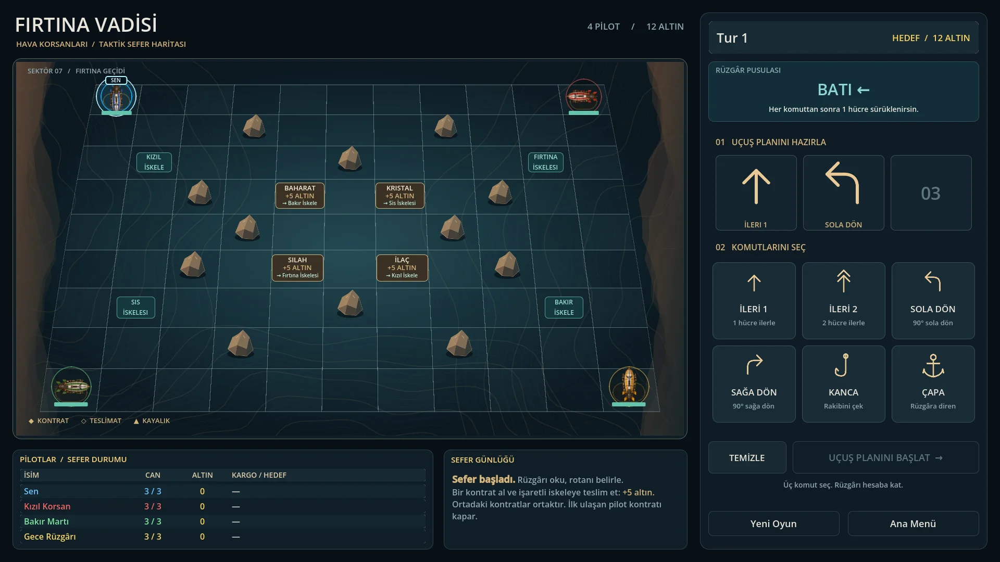

# Fırtına Vadisi — Godot 4 Prototype

Perspektifli 11×9 kanyon tahtasında 1 insan oyuncu ve 3 botla oynanan,
üç komut programlamalı zeplin/kargo oyunu.

## Çalıştırma

Godot 4.6 veya üzeri ile `project.godot` dosyasını açın ve F5'e basın.
İlk açılışta görseller içe aktarılır; `.godot` klasörü sürüm kontrolüne dahil değildir.

## Kurallar

- Her tur üç komut seçilir: İleri 1, İleri 2, Sola Dön, Sağa Dön, Kanca, Çapa.
- Her komuttan sonra o turun rüzgârı uygulanır. Çapa yalnızca sıradaki rüzgârı engeller.
- İleri 2 hareketi iki ayrı hücre adımıdır. Kargo alımı ve teslimat her adımda,
  kanca hareketinden sonra ve rüzgârdan sonra kontrol edilir.
- Dört köşe hücresinde başlayan pilotlar, merkezdeki dört ortak kontrat için yarışır.
- Her kontrat 5 altın kazandırır. Teslim edilen veya düşen geminin taşıdığı kontrat
  kaynak hücresine geri gelir. En az 12 altına ulaşan kazanır (üç teslimat).
- Aynı hedef hücreye hareket ve kafa kafaya geçiş engellenir. Boşalan hücrelere
  eşzamanlı hareket ve domino itişi desteklenir. Kayalar/sınırlar hasar verir.
- Canı biten zeplin kargosunu kaybeder ve başlangıcında, doluysa yakınındaki boş
  bir hücrede onarılır.
- Botlar mevcut rüzgârı ve statik engelleri hesaba katarak kontrat/teslimat rotası
  arar. Rakiplerin gizli programlarını önceden bilmez; çarpışmalar rotayı değiştirebilir.
- Ana menüye dönmek devam eden turu iptal eder. Başlat ve Yeni Oyun yeni maç açar.
- Ayarlar: tam ekran/pencere ve komutlar arası bekleme süresi; seçimler kaydedilir.

## Kod ve sahneler

- `scenes/main.tscn` + `scripts/main_ui.gd`: aktif arayüz, kontratlar ve başlangıçlar.
- `scripts/main.gd`: tur, hareket, çarpışma, kanca, rüzgâr, bot ve zafer mantığı.
- `scenes/board.tscn` + `scripts/board_topdown.gd`: perspektifli tahta ve sahne öğeleri.
- `scripts/board.gd`: ortak tahta API'si ve animasyon yönetimi.
- `scenes/airship_token.tscn` + `scripts/airship_token.gd`: zeplin görselleri ve göstergeleri.

## Regresyon kontrolü

```sh
godot --headless --path . --editor --import
godot --headless --path . --script tests/regression.gd
```

Testler yeniden başlatma, tur iptali, çapa, ara hücre kargosu, teslimat, yeniden doğma,
çarpışmalar, domino itişi, eşzamanlı hareket ve bot rotalarını kapsar.

## Görsel tasarım

Oyun ekranı petrol mavisi ve pirinç paleti, vadi konturları, vektör kaya/komut görselleri ve okunaklı bir uçuş konsolu kullanır. Seçili komuta tıklayarak sıradan çıkarabilirsiniz.

Görsel düzen `scripts/presentation.gd` üzerinden uygulanır; vektör kaynaklar `assets/ui/` içindedir. Ana sahnenin çalışma zamanındaki görünümü aşağıdadır.



## Geliştirme ve yapay zekâ ile çalışma

Yol haritası: [TODO.md](TODO.md). Ortak çalışma kuralları: [AGENTS.md](AGENTS.md).
Claude Code giriş yönergesi: [CLAUDE.md](CLAUDE.md).
ChatGPT ile depoyu inceletirken önce `AGENTS.md` dosyasını okumasını isteyin.
Bu dosyalar hesap/model kotası ayarı değil, gereksiz okuma ve açıklamayı azaltan proje talimatlarıdır.

## Rota önizlemesi

Komut seçerken altın düz çizgiler motor adımlarını, mavi kesik çizgiler rüzgârı ve numaralar komut sonlarını gösterir. Kırmızı çarpılar duvar/kaya veya mevcut rakip konumlarından doğan riski belirtir. Rakiplerin gizli komutları hesaba katılmaz; gemi/kanca etkileşimi veya gövdenin tükenmesi sonrası belirsiz rota uzatılmaz. Önizleme oyun durumunu değiştirmez, çözüm sırasında kapanır.

## Kontrat ve hedef takibi

Taşınan yük, hedef iskele ve altın ödülü uçuş konsolunun alt kısmında gösterilir. Oyuncunun hedef iskelesi altın çerçeveyle vurgulanır. Kontratların ve iskelelerin üzerine gelerek ayrıntıları görebilirsiniz. Teslimat, yeniden doğma, menü ve yeni maç eski hedef işaretini temizler; rakiplerin yükleri oyuncunun hedefini değiştirmez.
