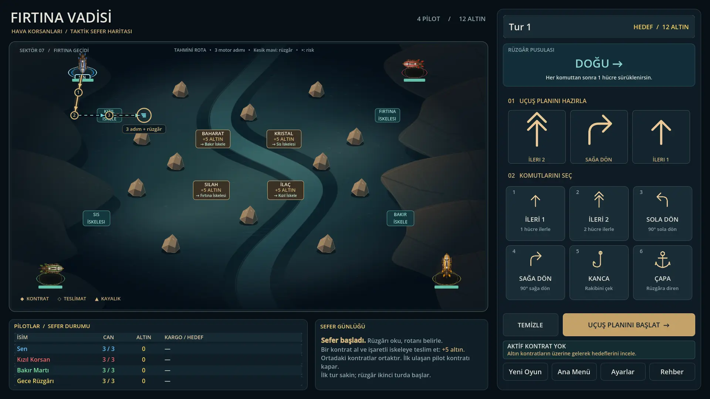
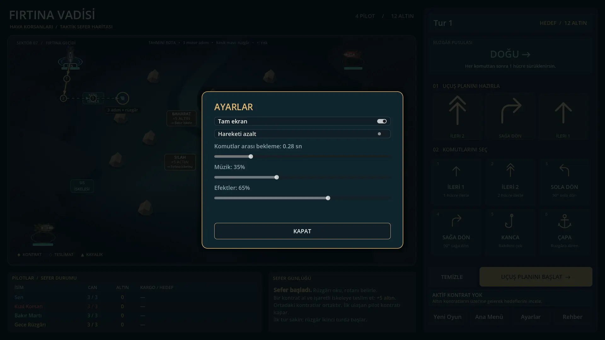
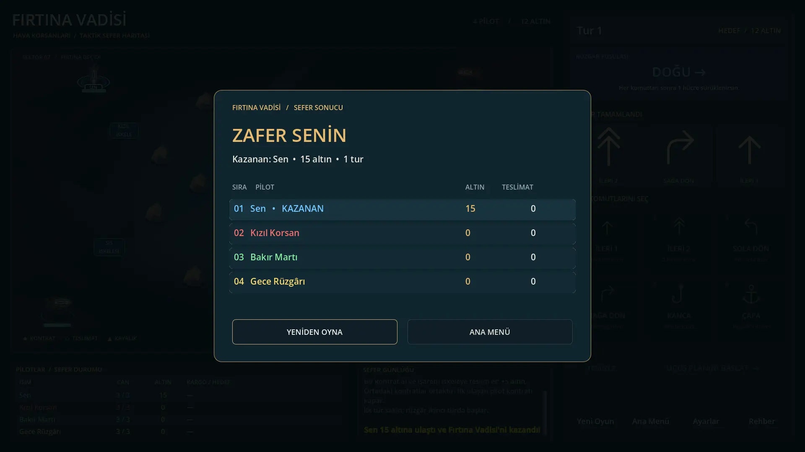

# Fırtına Vadisi

Perspektifli 11×9 kanyon tahtasında 1 insan oyuncu ve 3 botla oynanan,
üç komut programlamalı zeplin/kargo oyunu. Sürüm 1.0.0.

## Çalıştırma

Godot 4.6 veya üzeri ile `project.godot` dosyasını açın ve F5'e basın.
İlk açılışta görseller içe aktarılır; `.godot` klasörü sürüm kontrolüne dahil değildir.
Proje Godot 4.7 editöründe düzenlenir; testler ve dışa aktarma Godot 4.6.1 ile doğrulandı.

## Paketleme (Windows)

1. Godot editöründe **Editör → Dışa Aktarma Şablonlarını Yönet** ile editör sürümünüzün şablonlarını indirin.
2. **Proje → Dışa Aktar** penceresinde hazır **Windows** ön ayarını seçip **Projeyi Dışa Aktar** deyin.
   Çıktı `build/windows/FirtinaVadisi.exe` olur; veri dosyası exe'nin içine gömülüdür, tek dosya dağıtılır.
3. Komut satırından: `godot --headless --path . --export-release "Windows" build/windows/FirtinaVadisi.exe`

`Linux` ön ayarı da vardır. `build/` klasörü sürüm kontrolüne dahil değildir.
Ayarlar Windows'ta `%APPDATA%\Godot\app_userdata\Fırtına Vadisi\settings.cfg` dosyasında tutulur.
Exe simgesi Godot'nun varsayılanıdır; özel simge için rcedit kurup ön ayarda `application/modify_resources` açılabilir.

## Kontroller

- Fare: komut kartına tıkla; seçili komuta tıklayınca sıradan çıkar.
- Klavye: **1–6** komut seç, **Enter** uçuş planını başlat, **Backspace** son komutu geri al,
  **Delete** programı temizle, **Esc** ayarları aç/paneli kapat, **F1** rehber.
- İlk maçta kısa bir rehber açılır; menüdeki **Nasıl Oynanır** ve oyundaki **Rehber** ile yeniden açılır.

## Kurallar

- Her tur üç komut seçilir: İleri 1, İleri 2, Sola Dön, Sağa Dön, Kanca, Çapa.
- Her komuttan sonra o turun rüzgârı uygulanır. Çapa yalnızca sıradaki rüzgârı engeller.
  İlk tur sakindir; köşelerdeki pilotlar komut seçmeden duvara itilmez.
- İleri 2 hareketi iki ayrı hücre adımıdır. Kargo alımı ve teslimat her adımda,
  kanca hareketinden sonra ve rüzgârdan sonra kontrol edilir.
- Dört köşe hücresinde başlayan pilotlar, merkezdeki dört ortak kontrat için yarışır.
- Her kontrat 5 altın kazandırır. Teslim edilen veya düşen geminin taşıdığı kontrat
  kaynak hücresine geri gelir. En az 12 altına ulaşan kazanır (üç teslimat).
- Aynı hedef hücreye hareket ve kafa kafaya geçiş engellenir. Boşalan hücrelere
  eşzamanlı hareket ve domino itişi desteklenir. Kayalar/sınırlar hasar verir.
- Kancalar aynı anda çözülür: hedef bir hücre çekilir; karşı yönlerden çekilen hedef yerinde kalır.
- Canı biten zeplin kargosunu kaybeder ve başlangıcında, doluysa yakınındaki boş
  bir hücrede onarılır; o turun kalan komutlarını uygulamaz ve rüzgârla sürüklenmez.
- Aynı anda birden fazla pilot 12 altını geçerse çok altını olan, eşitse kalan gövdesi
  fazla olan kazanır; ikisi de eşitse ortak zafer ilan edilir.
- Botlar rüzgârı ve statik engelleri hesaba katan maliyetli bir arama yapar: güvenli rota
  yoksa kaçınılmaz 1 hasarı kabul eder, son canındayken ölümcül hamle yapmaz.
  Rakiplerin gizli programlarını önceden bilmez; çarpışmalar rotayı değiştirebilir.
- Ana menüye dönmek veya Yeni Oyun, tur çözülürken bile devam eden turu güvenle iptal eder.
- Ayarlar (menüden veya maç içinden, maçı durdurmadan): tam ekran/pencere, hareketi azalt,
  komutlar arası bekleme, müzik ve efekt seviyesi; seçimler kaydedilir. Pencere modu ekrana sığacak
  şekilde 16:9 boyutlanır ve ortalanır.

## Kod ve sahneler

- `scenes/main.tscn` + `scripts/main_ui.gd`: aktif arayüz, kontratlar ve başlangıçlar.
- `scripts/main.gd`: tur, hareket, çarpışma, kanca, rüzgâr, bot ve zafer mantığı.
- `scenes/board.tscn` + `scripts/board_topdown.gd`: perspektifli tahta ve sahne öğeleri.
- `scripts/board.gd`: ortak tahta API'si ve animasyon yönetimi.
- `scenes/airship_token.tscn` + `scripts/airship_token.gd`: zeplin görselleri ve göstergeleri.

## Regresyon kontrolü

```sh
godot --headless --path . --editor --import
godot --headless --path . --script tests/regression.gd
```

Testler yeniden başlatma, tur iptali, çapa, ara hücre kargosu, teslimat, yeniden doğma,
çarpışmalar, domino itişi, eşzamanlı hareket, kancalar, eşitlik, bot rotaları, klavye
kısayolları, oyun içi ayarlar/rehber, pencere boyutu ve uçuş kaydı sınırını kapsar
(Godot 4.6.1: 2281 kontrol).

## Görsel tasarım

Oyun ekranı petrol mavisi ve pirinç paleti, vadi konturları, vektör kaya/komut görselleri ve okunaklı bir uçuş konsolu kullanır. Seçili komuta tıklayarak sıradan çıkarabilirsiniz.

Görsel düzenin kaynağı `scenes/main.tscn` ve `scenes/board.tscn` dosyalarıdır; Godot 2D editöründe doğrudan düzenlenebilir. `main.tscn` editörde oyun alanını gösterir; F5 ana menüden başlar. Menü tasarımını düzenlemek için MenuLayer görünürlüğünü açıp GameLayer görünürlüğünü kapatın. Oyun açılışta görünürlüğü kendisi ayarlar.

`presentation.gd` yalnızca ortak renk/stil yardımcıları ve komut ikonlarını sağlar; sahne düzenini yeniden oluşturmaz. Kartlar, slot içindeki Selected/Texture ve Caption, kargo paneli ve harita görselleri gerçek sahne düğümleridir. Tahtanın konum önizlemesi mevcut @tool betiğiyle güncellenir; ana oyun betiği editörde çalışmaz. Vektör kaynaklar `assets/ui/` içindedir.

Editör güvenlik kontrolü (Python 3 + Godot editör sürümü):

```sh
python tests/run_editor_preview.py --godot godot
```

Gerekirse `--godot` ile çalıştırılabilir dosyanın tam yolunu verin. Test, geçici proje kopyasında normal editör yaşam döngüsüne bağlı bir eklenti olarak çalışır; gerçek projede eklenti etkinleştirmez. Linux/Windows kullanıcı veri ve editör ayar dizinleri de geçici alana yönlendirilir. İki kez sahne açıp kapatır; ayarlara dokunmama, oyun/ses başlatmama ve düğüm/sinyal çoğaltmama kontrollerini korur. Motor hata/uyarıları, eksik sonuç veya 120 saniyelik zaman aşımı başarısız çıkış kodu üretir. Godot 4.6 Linux headless ile temiz kapanış doğrulandı. `--editor --script` ile özel SceneTree başlatan eski yöntem kullanılmaz.

Oyun, ayarlar ve sonuç ekranları (1920×1080; 1366×768 ve 1280×720'de de doğrulandı):





## Geliştirme ve yapay zekâ ile çalışma

Yol haritası: [TODO.md](TODO.md). Ortak çalışma kuralları: [AGENTS.md](AGENTS.md).
Claude Code giriş yönergesi: [CLAUDE.md](CLAUDE.md).
ChatGPT ile depoyu inceletirken önce `AGENTS.md` dosyasını okumasını isteyin.
Bu dosyalar hesap/model kotası ayarı değil, gereksiz okuma ve açıklamayı azaltan proje talimatlarıdır.

## Rota önizlemesi

Komut seçerken altın düz çizgiler motor adımlarını, mavi kesik çizgiler rüzgârı ve numaralar komut sonlarını gösterir. Kırmızı çarpılar duvar/kaya veya mevcut rakip konumlarından doğan riski belirtir. Rakiplerin gizli komutları hesaba katılmaz; gemi/kanca etkileşimi veya gövdenin tükenmesi sonrası belirsiz rota uzatılmaz. Önizleme oyun durumunu değiştirmez, çözüm sırasında kapanır.

## Kontrat ve hedef takibi

Taşınan yük, hedef iskele ve altın ödülü uçuş konsolunun alt kısmında gösterilir. Oyuncunun hedef iskelesi altın çerçeveyle vurgulanır. Kontratların ve iskelelerin üzerine gelerek ayrıntıları görebilirsiniz. Teslimat, yeniden doğma, menü ve yeni maç eski hedef işaretini temizler; rakiplerin yükleri oyuncunun hedefini değiştirmez.
